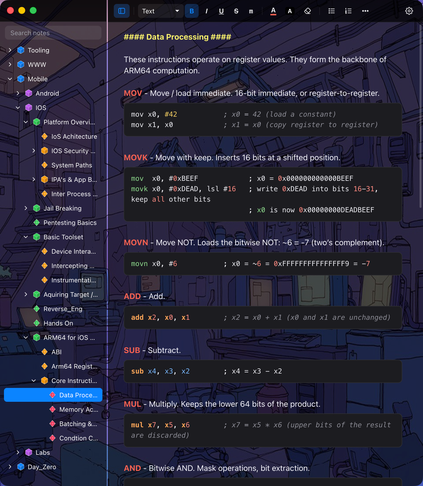

# Note4Me

**CherryTree's editing. Obsidian's files.**



CherryTree is very old, and it is amazing software. It has been around since
2009, long before "second brain" was a phrase, and it quietly got the hard
parts right: a tree of nodes, colour anywhere you want it, real code boxes
with syntax highlighting, and an editor that never gets in the way. A lot of
pentesters and sysadmins have a decade of notes in it for good reason.

The catch is where those notes live. Everything sits in one SQLite file that
only CherryTree can read, the Mac build has always been a bit of a stranger on
macOS, and a decade of notes is a lot to bet on any single project staying
alive.

Markdown is king. Files in a folder outlive any app, they diff, they grep,
and they open in Obsidian, VS Code or GitHub. But Markdown-only notes suck for
notes like these. There is no text colour or highlight. There is no real tree,
just folders. Every `*`, `_` and `#` inside a shell command picks a fight with
the syntax, and a code box is three backticks and a prayer.

Note4Me is the happy medium. The notebook on disk is nothing but Markdown
files and folders, and the editor behaves like CherryTree. If this app
disappears tomorrow, the notes are still there and still readable.

## What it takes from each

From CherryTree: the tree of nodes, each with its own page and its children
in a folder beside it. Text colour and highlight on any run of text, with a
palette you drive from the keyboard. Code boxes you type straight into.
Bullets that look like the ones people type by hand in CherryTree (`-`,
then `→`, then `⇒`). One line is one line: Enter gives you a new line, not a
new paragraph with a gap. And the Linux muscle memory, ⌃C and ⌃V, ⌃Z and ⌃Y,
⇧⌥F and ⇧⌥B for colours.

From Obsidian: every note is a plain `.md` file and the notebook is a folder.
Markdown as you type, so `**bold**`, `` `code` ``, `- ` lists and fences
turn into the real thing. Labels like `[GOAL]` tinted inline. And the big
one: nothing hidden in a database.

Colour is the one thing Markdown can't say, so it's written as
`<span style="color:#f66151">…</span>`, which every serious Markdown viewer
passes through untouched. The full on-disk contract is in
[FORMAT.md](FORMAT.md).

## Bringing your CherryTree notes over

Close CherryTree first, or convert a copy of the `.ctb`, so the database
isn't changing while you read it. Then:

```
python3 tools/ctb2md.py ~/Notes/Attack.ctb ~/Notes/Note4Me/Attack
```

Open that folder with **File ▸ Open Notebook…** (⌘O). The converter only
needs the Python standard library. It keeps the tree, the colours, the code
boxes and the images, drops the theme defaults (white on black) so the app
theme can decide, and turns lines you typed as `- item` into real lists.
Images get embedded in the note by default; pass `--assets` if you'd rather
have them as files in `_assets/`.

## Building it

macOS on Apple silicon. It's Electron, TipTap and esbuild. No server, no
account, no telemetry.

```
npm install
npm start              # bundle and launch from the source tree
npm run install-app    # build Note4Me.app, put it in /Applications, relaunch
npm run package        # just build the .app into out/
```

The app is ad-hoc signed, so it runs on the machine that built it. The app
and `npm start` share one settings file at
`~/Library/Application Support/Note4Me/settings.json`. While hacking on it,
`npm run watch` rebuilds on save and ⌘R reloads.

## Keys

Every shortcut can be changed in Settings › Keyboard. Click one, press the
new keys. Backspace clears it, ↺ puts the default back, and the switch at the
top turns all of them off.

| action | key |
|---|---|
| new node at the same level / new child node | ⇧⌘N / ⌘N |
| rename / delete node | F2 / ⌘⌫ (tree focused) |
| move node up / down | ⌥⌘↑ / ⌥⌘↓ |
| indent / outdent node | ⌥⌘→ / ⌥⌘← |
| previous / next node | ⌘↑ / ⌘↓ |
| bold / italic / underline / strike / mono | ⌘B / ⌘I / ⌘U / ⇧⌘X / ⌘E |
| text colour / highlight palette | ⇧⌥F / ⇧⌥B |
| re-apply last text colour / highlight | ⇧⌥G / ⇧⌥H |
| clear formatting | ⇧⌘\ |
| normal text / heading 1 / 2 / 3 | ⌥⌘0 / ⌥⌘1 / ⌥⌘2 / ⌥⌘3 |
| bullet / numbered list | ⇧⌘8 / ⇧⌘7 (Tab / ⇧Tab to nest, even on the first bullet) |
| code box | ⇧⌥⌘C (Tab indents, triple Enter or ↓ on the last line gets out) |
| select next / previous word | ⌃⇧→ / ⌃⇧← |
| select to end / start of line | ⇧⌥↓ / ⇧⌥↑ |
| copy / cut / paste / select all, Linux style | ⌃C / ⌃X / ⌃V / ⌃A |
| undo / redo, Linux style | ⌃Z / ⌃Y (or ⌃⇧Z) |
| paste without formatting | ⌃⇧V or ⇧⌘V |
| find in note / find and replace / search all notes | ⌘F / ⌃H / ⇧⌘F |
| bigger / smaller / reset text | ⌘= / ⌘- / ⌘0 |
| settings | ⌘, |
| show or hide the tree | ⌘\ |

Right-click a node for the same tree operations.

## The small things

**Markdown while typing** is on by default (Settings › Editor, or the Format
menu). `**bold**`, `*italic*`, `` `code` ``, `~~strike~~` and ```` ``` ````
fences format as you go, pasted plain text is read as Markdown, and labels
like `[GOAL]` get tinted. `# ` deliberately stays as text, so section titles
written as `#### Like This ####` stay the way they were typed; headings are
on ⌥⌘1 to 3. Turn it off for a note full of regexes. `- ` and `1. `
lists work either way.

**Bullets** show as `-`, then `→`, then `⇒` as you nest (then `•`, `◇`, `▪`),
which is how CherryTree notes tend to be typed by hand. The file still says
`- `. Tab works on the first bullet of a list too, which most editors
refuse.

**Colour stops where the coloured text stops.** Type after a red word, or
press Enter, and you're back to normal. Edit inside a red word and it stays
red. Pick a colour with nothing selected and whatever you type next gets it.
If you prefer the usual editor behaviour where colour keeps going until you
change it, there's a switch in Settings › Editor.

**Code boxes** use highlight.js, guess the language when you don't pick one,
and grow with their content. ↓ on the last line or ↑ on the first gets you
out in one press.

**Find and replace** (⌃H) replaces the current match on Enter or everything
on ⌘Enter, keeps the formatting of whatever it replaces, and scrolls each
match to the middle of the screen so you can see what you're doing. With
"Drop emptied lines" on, replacing something with nothing also removes the
line or bullet it left empty.

**Search** at the top of the tree looks through the contents of every note
and lists the matching lines grouped by note. Enter on a hit jumps to it.
There are toggles for case, regular expressions, and searching titles only.

**Images** pasted from the clipboard are embedded in the note itself, so the
folder holds nothing but notes. If you'd rather have files, switch to
`_assets/` in Settings. Drag an edge or the corner to resize, Shift to keep
proportions, double-click to reset.

**Export** is a right-click on a node: it writes that node and its children
as plain Markdown for people who don't have the app, with colours stripped,
images as files, and titles as headings.

**Themes**: Modern dark and light, Classic dark and light (the light tree
and black editor CherryTree people will recognise), Dracula, Nord, Solarized,
or a custom palette where every surface colour is yours. There's window
transparency, a few tree icon styles with a brightness slider, and spell
check with a right-click dictionary.

## Where things are

```
src/main/main.js        Electron main: notebook folder I/O, node ops, menus, nb:// protocol
src/main/preload.js     IPC bridge exposed as window.api
src/shared/shortcuts.js every shortcut, shared by the menu, the window and Settings
src/renderer/app.js     tree, toolbar, editor extensions and commands
src/renderer/md.js      Markdown <-> ProseMirror (the format contract)
src/renderer/styles.css themes and layout
src/renderer/settings.* the Settings window
tools/ctb2md.py         CherryTree .ctb -> Markdown tree
build/                  icon, packaging and install scripts
```

For headless checks there's a dev hook: `NOTE4ME_HIDDEN=1 NOTE4ME_SHOT=out.png
NOTE4ME_SHOT_JS='…' npx electron .` launches the app without showing a
window, runs the script inside the page, prints its return value as
`shot js:` and exits.

## Purely vibe coded

Not a line of this was written by hand. The app, the converter, the on-disk
format and this README all came out of Claude Code from requests like
"colour should go back to white on the next character" and "Tab on the first
bullet should make it deeper". The human's job was deciding what it should
do, using it every day on a real notebook of about 800 nodes, and saying what
felt wrong. Read the code with that in mind.

## Status

Built for one person's notebook and used daily. Mac only for now, no sync,
no plugins. If it ever eats your notes, they are still Markdown files in a
folder, which was the whole point.
